# TANTARA

TANTARA is a local-first workspace for arbitration matters. It combines case and client management, document ingestion, cited legal research, drafting, filing bundles, calendar, tasks, and community tools in one authenticated application.

## Architecture

The browser uses the Next.js workspace. API requests go through its same-origin `/api/v1` rewrite to FastAPI. SQLAlchemy stores owner-scoped records in SQLite; uploaded files and generated paperbooks live under the configured workspace data directory.

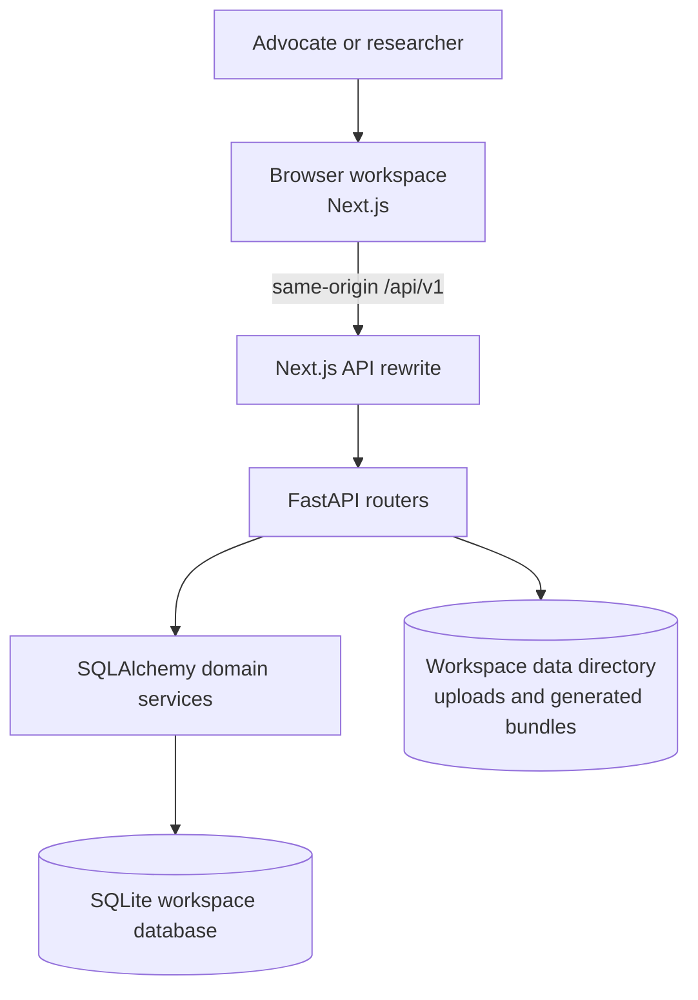

## Document ingestion data flow

Uploads are stored under the workspace data directory. Ingestion extracts text and page metadata, using OCR where a document has no usable text layer. Page-aware chunks feed both lexical and semantic indexes.

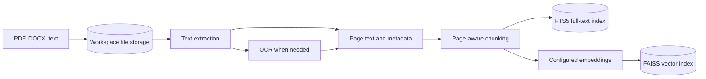

## Search and query lifecycle

Search and answer requests are scoped by the authenticated owner and any selected collections before hybrid ranking. Answers retain source citations. If the configured generation model is unavailable, the application reports that state rather than presenting a grounded answer.

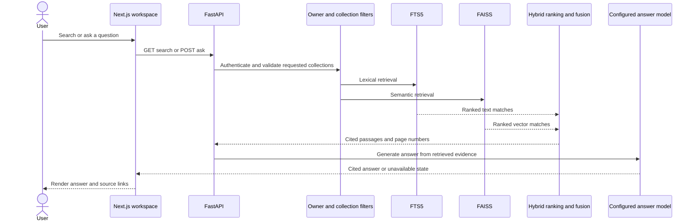

## Repository layout

- `frontend/` — Next.js application, UI modules, and Playwright end-to-end tests.
- `backend/app/` — FastAPI application, domain models, API routers, and retrieval services.
- `backend/alembic/` — database migrations.
- `scripts/` — workspace seeding and development utilities.
- `docs/` — API notes, integration reports, design references, and current screenshots.

## Local development

Use Python 3.11 or newer, Node.js, and pnpm. From the repository root, install the backend and frontend dependencies:

```bash
python -m venv backend/.venv
backend/.venv/bin/pip install -r backend/requirements-dev.txt
cd frontend && pnpm install
```

In a backend terminal, set a new workspace directory, seed its demo data once, and start the API:

```bash
cd /path/to/tantara
export TANTARA_DATA_DIR="$PWD/.tantara-data"
export DATABASE_URL="sqlite:///$TANTARA_DATA_DIR/tantara.db"
backend/.venv/bin/python scripts/seed.py --demo
cd backend
../backend/.venv/bin/python -m uvicorn app.main:app --host 127.0.0.1 --port 8010
```

The demo seeder refuses to append to an existing populated workspace. Keep the data directory if you want to keep its data; use a new directory for a separate demo workspace.

In another terminal, start the frontend. It uses the same-origin API rewrite, which defaults to the local API above:

```bash
cd /path/to/tantara/frontend
TANTARA_API_ORIGIN=http://127.0.0.1:8010 pnpm dev
```

Open `http://127.0.0.1:3010`. The workspace timezone defaults to `Asia/Kolkata`; configure it with `TANTARA_WORKSPACE_TIME_ZONE` when needed. AI provider and embedding settings are read from the backend environment. The application reports unavailable model services in the UI.

## Configuration reference

The backend reads these settings from its environment (and the repository's local environment files when present). Defaults below are the values in `backend/app/config.py`; keep credentials and local overrides out of Git.

| Setting | Aliases | Default | Purpose |
|---|---|---|---|
| Data directory | `TANTARA_DATA_DIR`, `DATA_DIR` | `<repo>/backend/data` | SQLite database, uploads, generated bundles, vector index, and local secret. |
| Workspace timezone | `TANTARA_WORKSPACE_TIME_ZONE` | `Asia/Kolkata` | Wall-clock interpretation and display for workspace dates. |
| Local model base URL | `TANTARA_LOCAL_LLM_BASE_URL`, `LOCAL_LLM_BASE_URL` | `http://192.168.0.101:8080/v1` | OpenAI-compatible chat endpoint. Configure an endpoint reachable from the backend host. |
| Local model name | `LOCAL_LLM_MODEL` | `MiniCPM5-2B` | Model identifier sent to the configured provider. |
| Embedding model | `FASTEMBED_MODEL` | `sentence-transformers/all-MiniLM-L6-v2` | Local 384-dimensional text embeddings. |
| CORS origins | `CORS_ORIGINS`, `TANTARA_CORS_ORIGINS` | `http://localhost:3000`–`:3020` and `http://127.0.0.1:3000`–`:3020` | Development browser origins accepted by the API. The standard frontend on 3010 is included. |

The browser's `/api/v1` requests use the Next.js same-origin rewrite. `TANTARA_API_ORIGIN` configures the rewrite target, and Playwright's web origin is `TANTARA_WEB_URL`; the default test stack is `127.0.0.1:8010` plus `127.0.0.1:3010`.

## Authorization and seeded data

The demo seed creates `advocate@tantara.local`, `researcher@tantara.local`, and `staff@tantara.local`. Demo credentials are defined by the local seed script; use them only in a disposable local workspace. The advocate owns 12 cases, 8 documents, 17 tasks, 7 clients, and 1 filing bundle. The researcher owns 1 case, 1 document, and 1 bundle, so the database census is 13 cases, 9 documents, 18 tasks, 8 clients, and 2 bundles. The seed prints counts by owner, and refuses to append to a non-empty data directory unless explicitly reset.

Resource reads are owner-scoped: requesting another user's case, document, draft, client, task, or bundle returns 404 so the API does not reveal that the record exists. Read-only roles may inspect permitted workspace data, while restricted writes such as creating cases and filing bundles return 403. These behaviors are covered by API and browser authorization tests.

## API contracts

Collection endpoints use the envelope `{items, total, page, page_size, pages}`. The calendar endpoint preserves its legacy bare-array response by default; callers that need pagination metadata can request `?envelope=true`. Search uses the `query` parameter (not `q`) and supports owner-scoped collection filters. Errors use `{error: {code, message, details?}}`; validation rejects unknown request fields with `validation_error` and an `extra_forbidden` detail. Wrong HTTP methods use `method_not_allowed`.

The most-used endpoints are:

| Capability | Endpoint | Notes |
|---|---|---|
| Hybrid document search | `GET /api/v1/search/documents?query=...` | Returns page-aware hits and relevance scores; accepts `collection_ids`. |
| Grounded Research Desk | `POST /api/v1/ai/ask` | Returns an answer state, citations, source excerpts, and disclaimer. Generation failure remains explicit. |
| Calendar | `GET /api/v1/calendar?from=...&to=...` | Includes hearings, deadlines, and case events with workspace-local offsets. |
| Collections | `GET /api/v1/collections` and `GET /api/v1/collections/{id}` | Owner-scoped collection list/detail with document counts. |
| Paperbooks | `GET /api/v1/bundles/{id}` and bundle PDF endpoints | Detail includes sections, items, and page count; files resolve under the workspace data directory. |

## Hybrid retrieval

The retrieval service searches SQLite FTS5 using BM25 and FAISS `IndexFlatIP` using normalized embedding vectors. It fuses the independently ranked candidate pools with reciprocal-rank fusion (RRF), then labels the resulting score **Relevance**. Search and question answering apply owner and selected-collection scope before ranking; citations preserve `document_id`, `chunk_id`, and `page_number` so the UI can open the source page. The model is used for answer generation, not for retrieval itself. If it is unreachable, the API keeps the honest unavailable response and does not invent a conclusion.

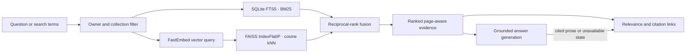

## Module map

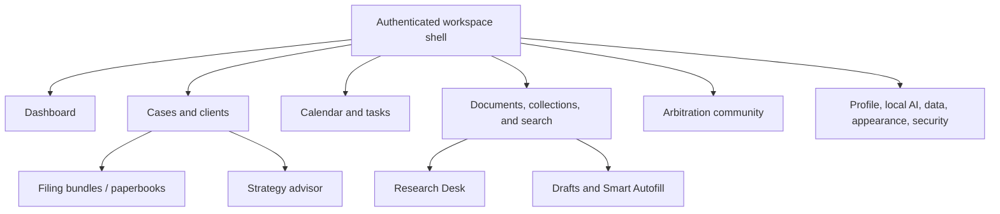

## Data storage layout

`TANTARA_DATA_DIR` is the single root for mutable workspace state. The database defaults to `tantara.db` inside that directory; Alembic migrations define its schema. Uploaded documents live below `uploads/`, generated paperbooks below `bundles/`, vector-index files below `index/`, and the local signing secret is stored as `.secret`. Database rows store paths relative to this root, and storage resolution checks containment before opening a file. Moving or copying the complete directory therefore preserves document and bundle access; the path migration rewrites existing absolute paths.

## Validation

```bash
cd frontend
pnpm lint
pnpm typecheck
pnpm build
pnpm exec playwright test

cd ../backend
../backend/.venv/bin/python -m pytest -q --cov=app
```

Playwright starts an isolated migrated and demo-seeded backend and frontend using the configured test origins. Its test API origin is `TANTARA_API_ORIGIN`; the web origin is `TANTARA_WEB_URL`.

## Workspace screenshots

These desktop and mobile captures come from the authenticated, demo-seeded workspace. Capture times are read from each image file mtime in UTC; desktop and mobile times are recorded separately.

| Module | Desktop (1440×900) | Mobile (390×844) | Rendered | Desktop captured (UTC) | Mobile captured (UTC) |
|---|---|---|---|---|
| Dashboard | 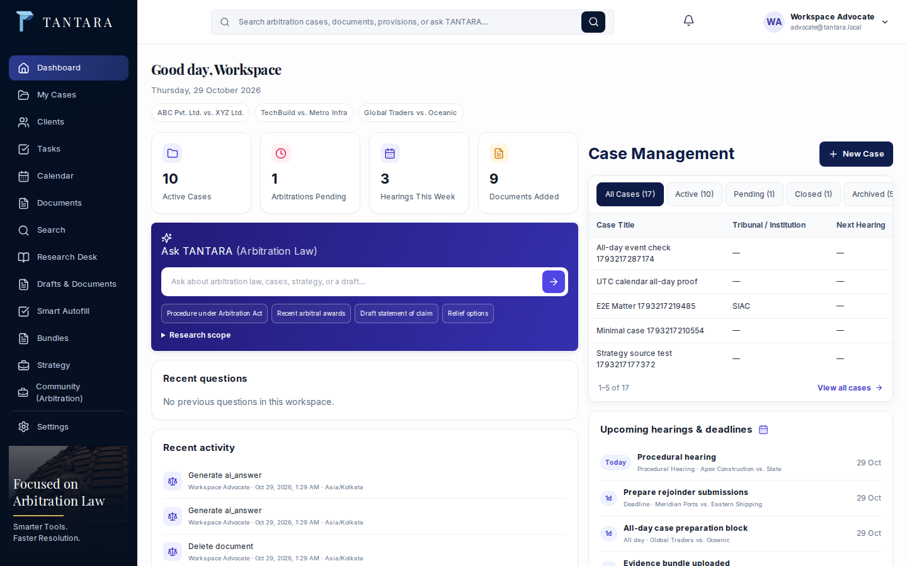 | 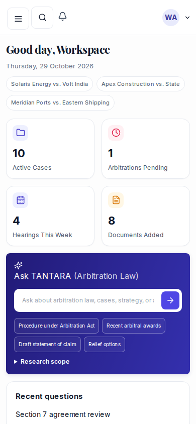 | 1440×900 / 390×844 | 10-28 20:01 | 10-28 11:59 |
| Cases | 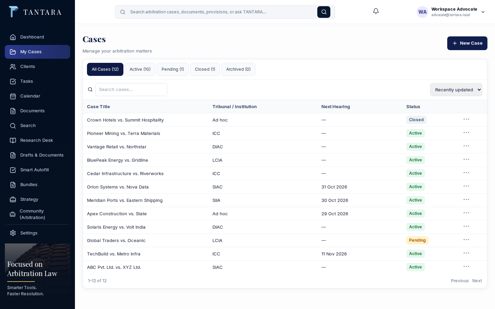 |  | 1440×900 / 390×844 | 10-28 11:59 | 10-28 11:59 |
| Clients | 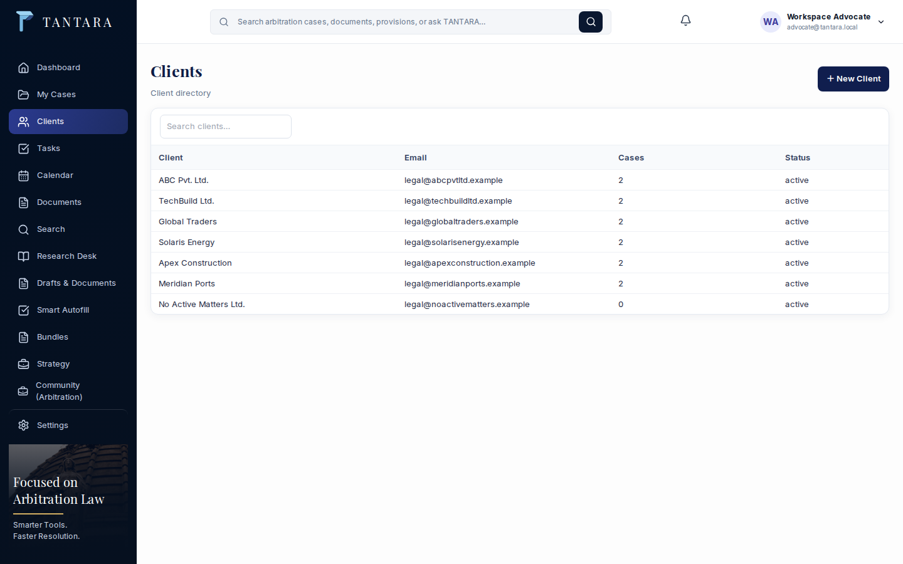 |  | 1440×900 / 390×844 | 10-28 11:59 | 10-28 11:59 |
| Tasks |  |  | 1440×900 / 390×844 | 10-28 20:01 | 10-28 11:59 |
| Calendar | 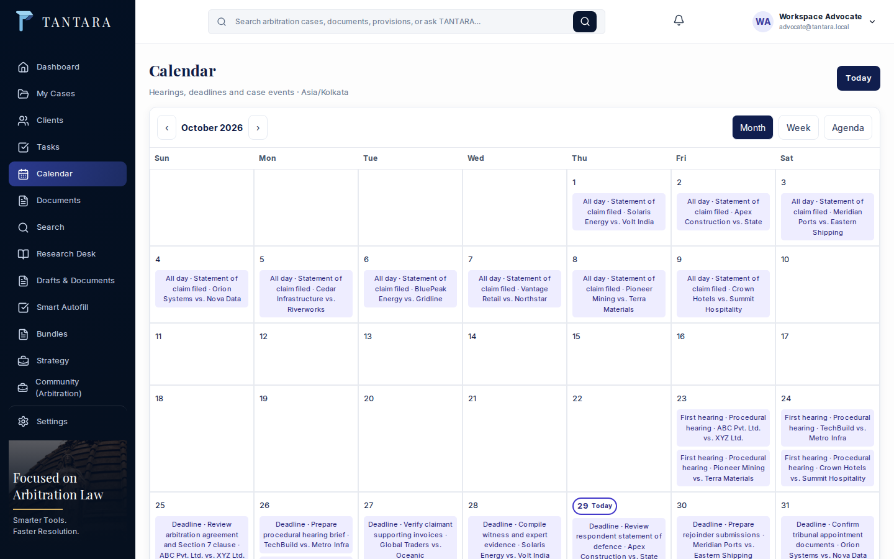 |  | 1440×900 / 390×844 | 10-28 20:01 | 10-28 11:59 |
| Documents | 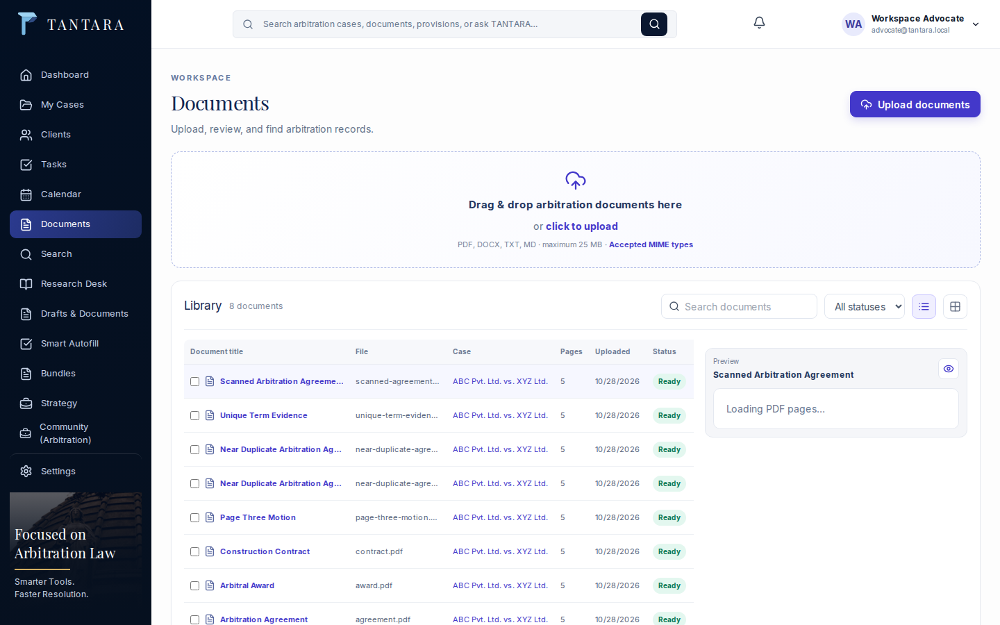 |  | 1440×900 / 390×844 | 10-28 11:59 | 10-28 11:59 |
| Search |  |  | 1440×900 / 390×844 | 10-28 12:06 | 10-28 12:06 |
| Research |  | 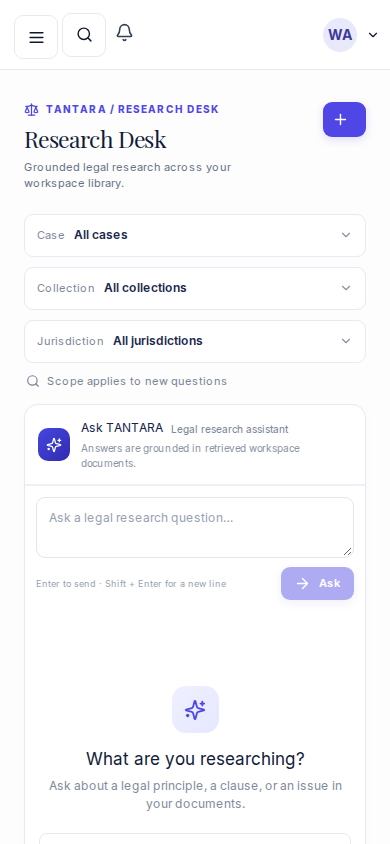 | 1440×900 / 390×844 | 10-28 11:59 | 10-28 11:59 |
| Drafts |  | 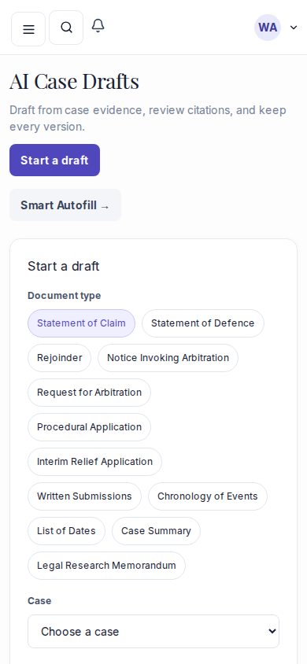 | 1440×900 / 390×844 | 10-28 11:59 | 10-28 11:59 |
| Autofill |  | 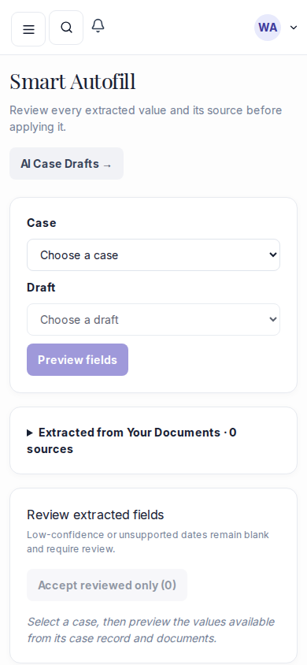 | 1440×900 / 390×844 | 10-28 12:06 | 10-28 12:06 |
| Bundles |  |  | 1440×900 / 390×844 | 10-28 11:59 | 10-28 11:59 |
| Strategy | 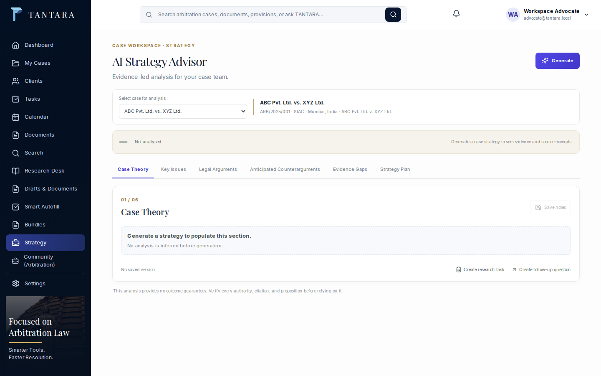 |  | 1440×900 / 390×844 | 10-28 12:06 | 10-28 12:06 |
| Community | 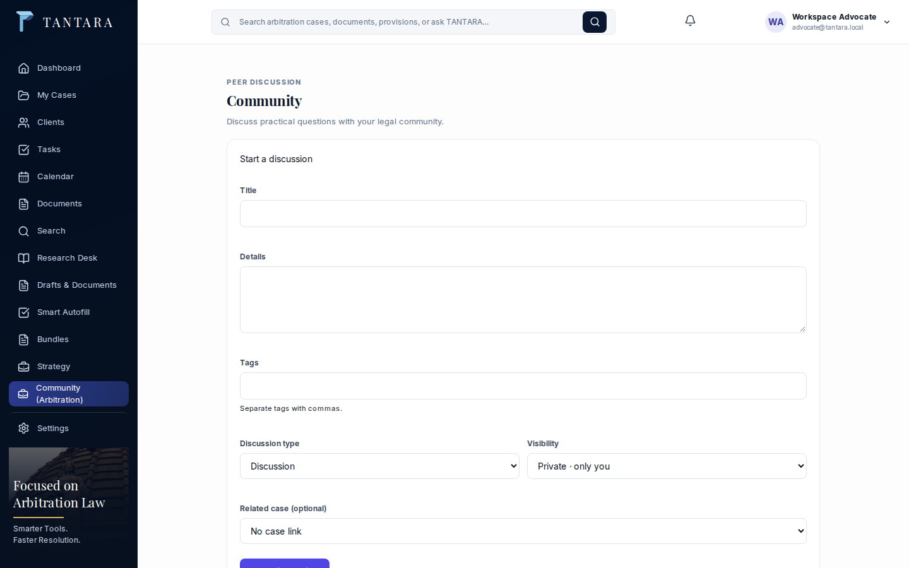 | 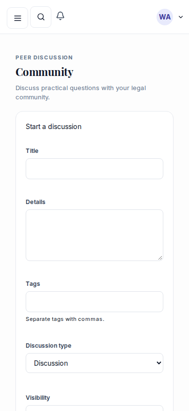 | 1440×900 / 390×844 | 10-28 11:59 | 10-28 11:59 |
| Settings |  | 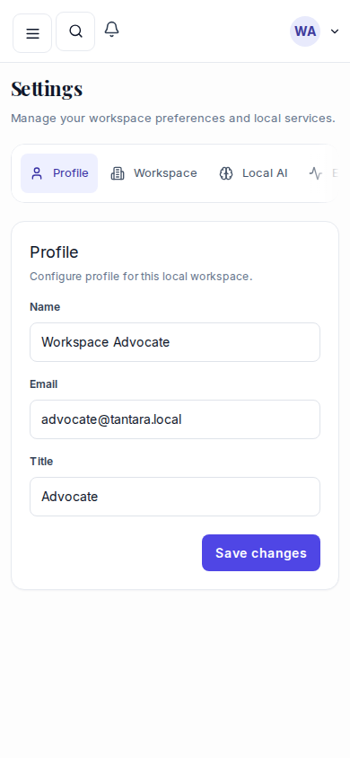 | 1440×900 / 390×844 | 10-28 11:59 | 10-28 11:59 |
